# CCTV network lab

A small version of the kind of camera network I worked on during my WIL placement (IP cameras on a live retail site), rebuilt in Cisco Packet Tracer and **secured**: the cameras get their own VLAN, staff can't reach them, the security office can only open the recorder's web page, and the camera ports only accept the camera that's meant to be there.

Built in Cisco Packet Tracer 9.0. Everything below is real output from the lab. Open [`cctv-network-lab.pkt`](cctv-network-lab.pkt) to try it.

Part of my networking labs: [ping and traceroute](https://github.com/yaseenselemane/ping-and-traceroute) · [nmap](https://github.com/yaseenselemane/nmap-field-notes) · [WiFi survey](https://github.com/yaseenselemane/wifi-survey) · [Wireshark](https://github.com/yaseenselemane/wireshark-packet-lab) · [Packet Tracer](https://github.com/yaseenselemane/cisco-packet-tracer-labs) · **CCTV network** · [subnet calculator](https://github.com/yaseenselemane/subnet-calculator) · [vantage](https://github.com/yaseenselemane/vantage)

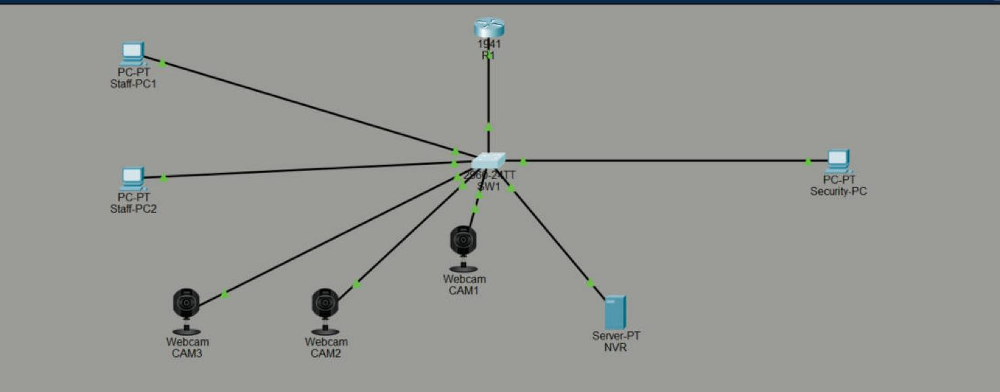

## The design

| VLAN | Who | Addressing | Port(s) on SW1 |
|---|---|---|---|
| 10 STAFF | Staff-PC1, Staff-PC2 | DHCP `192.168.10.x` | Fa0/6–7 |
| 20 CCTV | CAM1–3, NVR (recorder) | static: NVR `.10`, cameras `.21`–`.23` | Fa0/2–4 cameras, Fa0/5 NVR |
| 30 SECURITY | Security-PC | DHCP `192.168.30.x` | Fa0/8 |
| — | R1 (router-on-a-stick) | `.1` in each VLAN | Fa0/1 trunk ↔ R1 G0/0 |

**The rules:**

1. **Staff can't reach the CCTV VLAN at all.** A compromised office PC shouldn't be able to see or attack the cameras.
2. **The security office can open the NVR's web page and ping it, and nothing else** in the CCTV VLAN (not the cameras directly).
3. **The CCTV VLAN can only answer the security office.** Cameras can't start connections to anything outside their VLAN, so a hacked camera can't reach the office.
4. **Each camera port accepts one device, the camera.** Plug a laptop into a camera's cable and its traffic is dropped and logged.

Configs: [R1](configs/R1.txt) · [SW1](configs/SW1.txt)

## Building it, and what went wrong

**VLANs on the switch:**

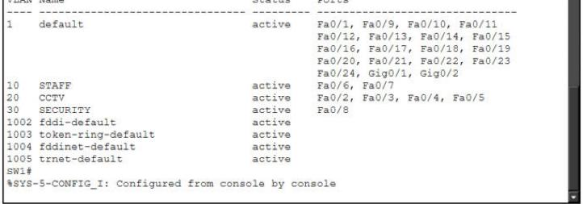

**Fault 1: the router's trunk port was "down".** I configured the sub-interfaces on G0/1, but `show ip interface brief` said `down` (not *administratively* down). The config was fine. The cable was plugged into **G0/0**. I moved the sub-interfaces to G0/0 and everything came up. Lesson: "down" is a cabling/link problem, "administratively down" is a config problem (`shutdown`).

**The NVR can see all three cameras** (same VLAN, no router involved):

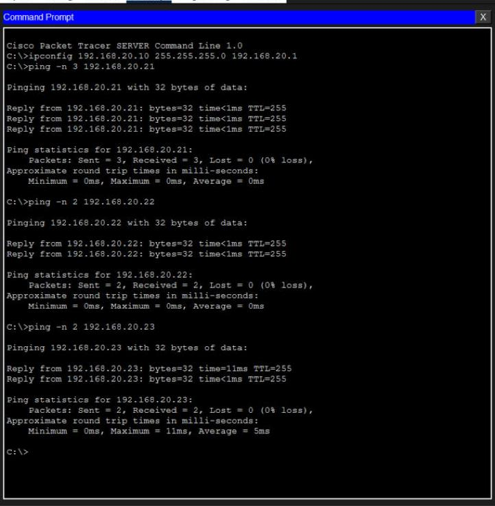

**Fault 2: the cameras had an open WiFi radio switched on.** While troubleshooting, I found every camera's second interface, **Wireless0**, was on and set to join an SSID called `HomeGateway` with **no authentication**. A real camera like that would happily join any open network with that name, which gives an attacker a way in. I turned the radio off on all three.

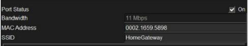

**Fault 3, the one I couldn't fix:** the Packet Tracer webcams answer pings from their own subnet (the NVR, R1) but never reply to other subnets, even with the correct default gateway set and the radio off. R1 → CAM1 is 5/5, while a PC → CAM1 through R1 times out. It looks like a limit of Packet Tracer's IoT webcam model rather than my config: the NVR, on the same VLAN with the same gateway, replies across subnets fine. So the cross-VLAN tests use the **NVR** as the target. That fits the design anyway, since nothing outside VLAN 20 should talk to the cameras directly.

## Proving the rules

**Before the ACLs**, a staff PC could reach the recorder:

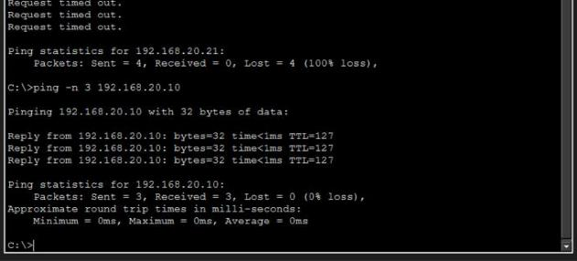

**The ACLs**, each applied *inbound* on the VLAN's sub-interface so traffic is checked as it enters the router:

```
ip access-list extended STAFF-IN
 deny ip 192.168.10.0 0.0.0.255 192.168.20.0 0.0.0.255
 permit ip any any
ip access-list extended SECURITY-IN
 permit tcp 192.168.30.0 0.0.0.255 host 192.168.20.10 eq 80        ! NVR web page
 permit icmp 192.168.30.0 0.0.0.255 host 192.168.20.10 echo
 deny ip 192.168.30.0 0.0.0.255 192.168.20.0 0.0.0.255              ! not the cameras
 permit ip any any
ip access-list extended CCTV-IN
 permit tcp host 192.168.20.10 eq 80 192.168.30.0 0.0.0.255 established   ! only replies
 permit icmp host 192.168.20.10 192.168.30.0 0.0.0.255 echo-reply
 permit icmp 192.168.20.0 0.0.0.255 host 192.168.20.1
 deny ip any any                                                    ! cameras can't start anything
```

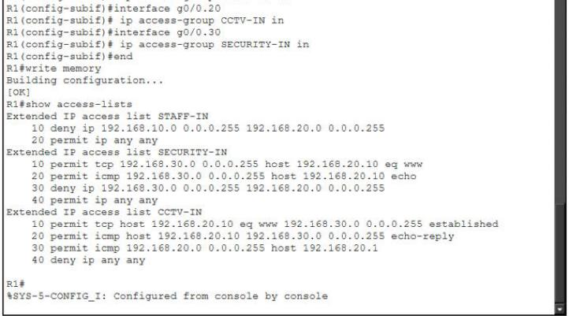

**After:**

| Test | Before | After |
|---|---|---|
| Staff-PC1 → NVR | ✅ 3/3 | ❌ *Destination host unreachable* from `192.168.10.1` |
| Security-PC → NVR web page | — | ✅ page loads |
| Security-PC → NVR ping | — | ✅ 3/3 |
| Security-PC → CAM1 | — | ❌ *Destination host unreachable* from `192.168.30.1` |

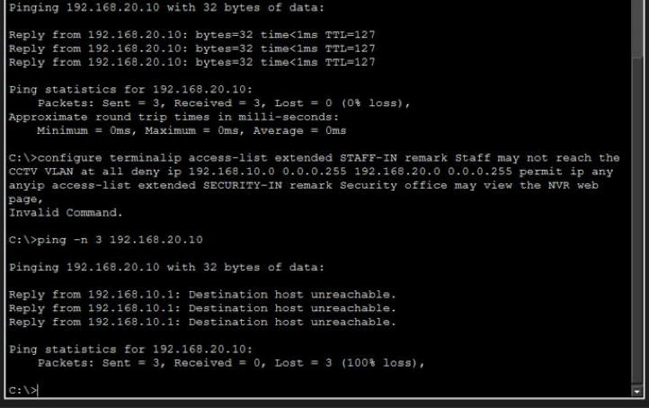
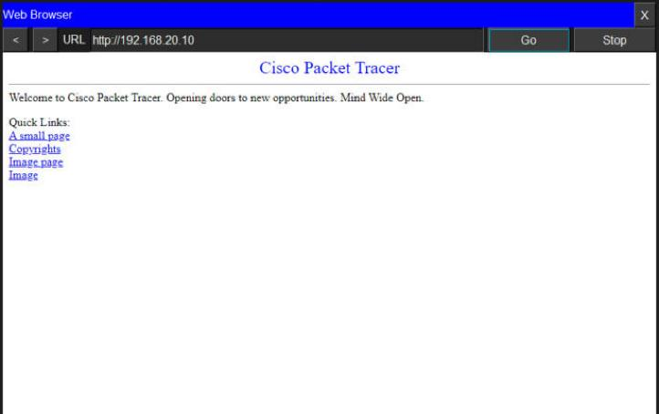
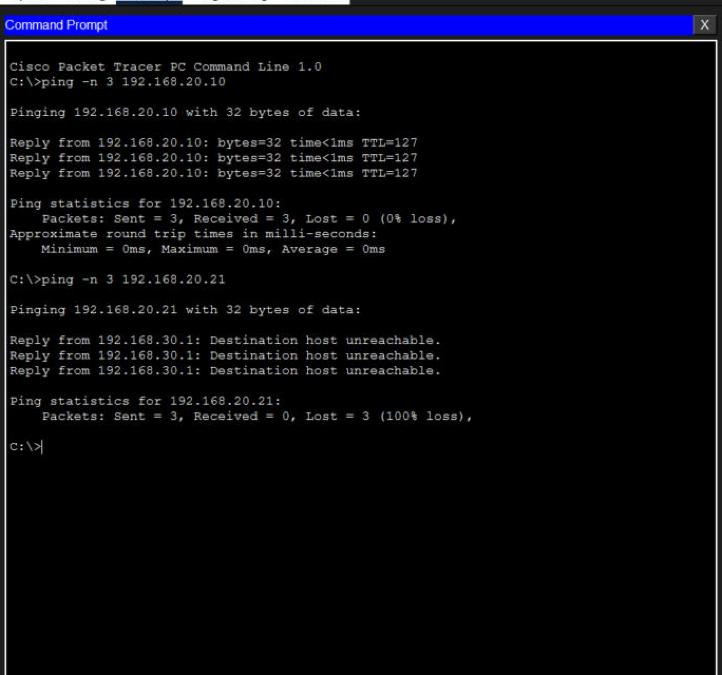

**The hit counters match every test:** STAFF-IN deny = 3 (the staff pings), SECURITY-IN web = 5 and ping = 3 (allowed), deny = 3 (the camera pings), and CCTV-IN `established` = 3 and `echo-reply` = 3 (the NVR's replies coming back):

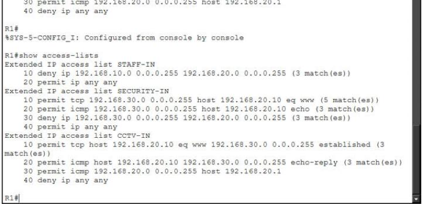

**Port security:** each camera port has learned exactly one MAC and stuck to it. Fa0/2's `00E0.B00A.6984` is CAM1's own MAC, which also confirmed the cabling map:

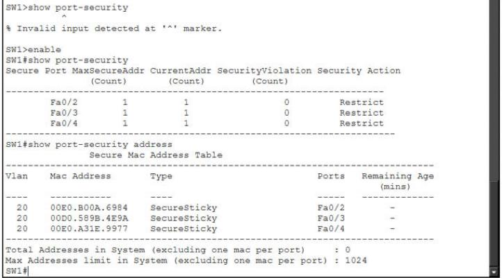

I used **`violation restrict`** here, not `shutdown` like in my [port security lab](https://github.com/yaseenselemane/cisco-packet-tracer-labs#lab-5-port-security--pkt). A camera port that shuts down means a blind spot until someone resets it. `restrict` keeps the real camera recording, drops the intruder's traffic and logs it.

---

## What I learned

1. **Cameras belong in their own VLAN.** They're often the least-patched devices on a network. Segmenting them means a hacked camera can't reach the office, and an infected office PC can't reach the cameras.
2. **Write the policy first, then the ACLs.** "Staff: nothing. Security: the NVR web page only. Cameras: reply only." Each sentence became a few ACL lines, and the hit counters proved each one.
3. **`established` makes an ACL one-way.** The CCTV VLAN can answer the security office's web requests, but can't start a TCP connection to anything.
4. **Put the deny where the traffic enters.** Inbound on each VLAN's sub-interface, so traffic is filtered before it's routed anywhere.
5. **"Down" vs "administratively down".** The first means check the cable or port (mine was on G0/0, not G0/1). The second means someone typed `shutdown`.
6. **IoT devices ship with surprises.** The cameras had an open-WiFi radio enabled by default. Real deployments should turn off every interface that isn't used.
7. **Port security mode is a design choice.** `shutdown` is safest, `restrict` keeps a camera recording while still blocking and logging intruders.
8. **Know the limits of your tools, and say so.** Packet Tracer's webcams wouldn't reply across subnets. I tested around it with the NVR instead of pretending it worked.
9. **This is the network I worked on at my placement, done properly.** On site we had cameras, Ubiquiti kit and VLANs. Rebuilding it showed me which security steps matter most.
